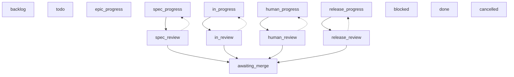

# Using the Factory workflow

The Factory workflow turns a spec into merged code. It is bound to every live project, so an
issue created in a project enters these columns; an issue outside a project uses the
workspace Default workflow, whose columns hand off to nobody.

The workflow file is the source: `templates/workflows/factory.json`. `just render-factory`
writes this guide's column table and status graph from it, and `tests/render-factory.test.js`
fails when the two differ. The prose around those blocks stays authored and is pinned by
`tests/factory-workflow.test.js`. This guide is the contract the human and the seats read. The
route allocation behind the graph is
[ADR-0004](adr/0004-columns-carry-agent-decided-routes.md); the approval artifact is
[ADR-0005](adr/0005-the-merged-spec-pr-is-the-approval.md); [ADR-0006](adr/0006-comment-first-merge-last.md)
records the handoff order and the auto-merge ban; [ADR-0007](adr/0007-publish-the-slice-in-the-spec-run.md)
moves the slice publication into the spec run; [ADR-0008](adr/0008-spec-approval-targets-the-integration-branch.md)
retargets the approval merge at the integration branch,
[ADR-0009](adr/0009-release-the-spec-as-one-squash.md) releases the spec as one squash on
`main`, and [ADR-0014](adr/0014-the-merge-exit-is-read-at-the-pass.md) reads the merge exit
once, at the PASS; [ADR-0016](adr/0016-every-grilled-slice-takes-the-integration-topology.md)
deletes the second topology and asks the labels at the kickoff.

## Status graph

<!-- factory:graph:start (generated from templates/workflows/factory.json; do not edit) -->

<!-- factory:graph:end -->

The graph is rendered from the workflow file: a solid arrow is the column's declared `next`, a
dotted arrow its declared `back`. Routes the instructions take beyond those edges — the
promotion into a work lane, the triage out of `blocked` — are rules in the prose, not a second
drawing. Any ticket can enter `blocked`; it is a triage column, never a parking spot. `done` and
`cancelled` are terminal and hand off to nobody. A merge completes the linked ticket: that is
the platform's PR rule, not a status edge. The four review columns all declare `awaiting_merge`
as their `next`, so the unattended advance is the human and the merge is the handled exception.
`epic_progress` is the epic's state and handles nobody: the Planner moves the epic there from
`todo` when it promotes the first delivery stage, and to `done` on acceptance.

## The kickoff labels step

Every grilling produces an epic, so every published slice takes this one topology: a stage-1
spec child, the `spec/<epic>` integration branch, the staged delivery children and a final-stage
release child. A single-ticket breakdown is the smallest epic — one delivery child and the
release — and a small task that never grills stays a regular ticket, the only PR into `main` with
no slice behind it.

The grilling packet ends on one question: which of `has-human-implementer` and `has-human-release`
to apply to the epic, or neither. The Planner applies the answer at the kickoff, before moving the
stage-1 child to `spec_progress`; the mode is set before the spec PR exists, so the whole slice
shares it. A label added later applies at the next PASS.

## The spec is a stage-1 child

The Planner creates the spec as the epic's stage-1 child and keeps the epic at `todo` until it
promotes the first delivery stage, when the epic moves to `epic_progress`. In that
child's run the Planner writes the spec, forks `spec/<epic>` from `main` at the spec sha before
the spec PR exists, publishes the whole slice with `to-tickets` — every delivery child under the
epic, in `backlog`, in stage order, the final-stage release child last — then
opens the spec PR carrying the proposed breakdown, against `spec/<epic>`, and links it only to
the child, never the epic, and never after `Closes`, `Fixes` or `Resolves`.
The Reviewer leaves the PR open on PASS and moves the child to `awaiting_merge`; the human
merges it, the workspace PR rule completes the child to `done`, and that completion wakes the
Planner to promote the frontier — not to slice. The merge still approves the spec and the set:
the children exist, but all are `backlog` and none has started.
No child is created after the merge: the set is final before the child closes.
Publishing before the child closes is what keeps the barrier wake single: the platform
re-evaluates the stage condition whenever the child set changes.

## One integration branch per spec

Each spec forks `spec/<epic>` from `main` at the spec sha, before the spec PR exists: a branch
needs a commit. The spec PR targets that branch, and its merge approves the spec, its proposed
breakdown and the published children exactly as before. Every delivery child opens its body
with `Branch: spec/<epic>`; that line, not a promotion comment, is the base the Implementer
reads. The stage is the dependency edge and the body carries no blockers. A final-stage release
child owns the only path from the branch to `main`.

```text
main ──fork at the spec sha──> spec/<epic>
                                  │  spec PR (approval) ───────────┐
                                  │  ticket PRs (reviewed, merged) ┤
                                  └── release child: spec → main ──┴──> one squash on main
```

`spec/*` is scratch: it is unprotected, it deploys nothing, and the release merge deletes it.
The branch's only jobs are to hold the reviewed spec until it is complete and to keep
half-finished work off `main`.

### The release child

The release child is published in the spec run, last, in `backlog`, in the final stage. Its
body carries its instance — base/source branch, included children and `Touch:` union; the
procedure itself lives in `roles/release.md`. It runs in `release_progress` and is reviewed at
`release_review`. Its PR is `spec/<epic>` → `main`: merge the current `main` in, resolve, run
the full suite and open at that head. That merge is one squash commit on `main` whose subject
carries the release ticket's key — no merge commit, no direct push — and it deletes the branch
because **Automatically delete head branches** is on.

CI runs at spec level: the release PR and the post-merge `main` push, two runs per spec
independent of N. Ticket PRs into `spec/<epic>` run no check, which is why the per-ticket gate
is the Implementer's local run of the check that covers the diff. A red release reworks on the
release ticket at `release_progress`, on the branch, and re-runs at the refreshed head; children
that are already `done` stay `done`.

### `done` has two scopes

`done` has two scopes: branch-scoped `done` for a child and `main`-scoped `done` for the epic.
A child's `done` means it was delivered and reviewed on `spec/<epic>`. The epic's `done` is
`main`-scoped: after the release merge completes the release child, the Planner verifies the
release squash is on `main` at the merged sha with the release PR's checks green and only then
accepts the epic. The release child is the visible "this spec is not on `main` yet" marker; no
new status is introduced for the meaning between the two.

### Release serialization

At most one release is merge-ready against `main` at a time. Before promoting a release the
Planner runs `gh pr list --base main --state open`, filters the heads to `spec/*`, and while
another release is open parks the next one on `--until-issue <release>`. A release whose
`main` moves while it waits merges `main` in again and re-runs the suite: it never merges a
stale tree. The Reviewer's `mergeStateStatus` check and the human's merge button are the second
and third detectors.

### The stale sweep

`stale-sweep` is the catalog's one stale-review guard: an hourly `0 * * * *` UTC autopilot in
the Planner role, mode `run_only`. It reads the four reviewer-handled columns — `spec_review`,
`in_review`, `human_review` and `release_review` — and dates each ticket from its `issue
timeline`, never from its last comment. A ticket two or more hours into its column gets one
`## What` / `## Evidence` / `## Next` comment carrying the age and the last actor, and then
moves to `blocked`; the comment is written first and the move is the last action.

It never sweeps `human_progress` or `awaiting_merge`: those wait indefinitely for the human, and
no agent may un-gate a human step. It never mentions anyone, never closes or cancels a ticket
and never runs on a `blocked` ticket. Triage restores the lane the timeline records; a second
sweep leaves a swept ticket in `blocked` for the human.

The first live run is the acceptance: the release reads the autopilot and its single enabled
hourly trigger back, and the first blocking move is the observable evidence.

### The cancelled-epic sweep

At approval the Planner registers `--until-status cancelled` on the epic. If the epic is
cancelled before its release merges, that sweep runs once and in order: close the open delivery
and release PRs, delete `spec/<epic>`, cancel the children that are still open, and record what
merged and what is abandoned. If the release already merged, do not cancel it: accept the epic,
or open a follow-up spec — a revert is a new epic.

## Columns

The column table and the presentation it carries are generated from the workflow file:

<!-- factory:columns:start (generated from templates/workflows/factory.json; do not edit) -->
| Column | Handler | Icon | Colour | Next | Back |
| --- | --- | --- | --- | --- | --- |
| `backlog` | none | — | — | — | — |
| `todo` | none | — | — | — | — |
| `epic_progress` | none | `half` | #0ea5e9 | — | — |
| `spec_progress` | Planner | `half` | #3b82f6 | `spec_review` | — |
| `spec_review` | Reviewer | `three_quarters` | #3b82f6 | `awaiting_merge` | `spec_progress` |
| `in_progress` | Implementer | — | — | `in_review` | — |
| `human_progress` | human | `half` | #8b5cf6 | `human_review` | — |
| `release_progress` | Release | `half` | #f97316 | `release_review` | — |
| `in_review` | Reviewer | — | — | `awaiting_merge` | `in_progress` |
| `human_review` | Reviewer | `three_quarters` | #8b5cf6 | `awaiting_merge` | `human_progress` |
| `release_review` | Reviewer | `three_quarters` | #f97316 | `awaiting_merge` | `release_progress` |
| `awaiting_merge` | human | `three_quarters` | #8b5cf6 | — | — |
| `blocked` | Planner | — | — | — | — |
| `done` | none | — | — | — | — |
| `cancelled` | none | — | — | — | — |
<!-- factory:columns:end -->

`done` and `cancelled` hand off to nobody. Custom statuses carry the presentation that sync
reconciles and reads back; a system status declares none. A column's declared `next` and `back`
are the only edges the graph owns; the route its instruction takes beyond them — the promotion
into a work lane, the triage out of `blocked` — is a rule in the prose.

## Promotion and the exit rule

The two labels compose into four modes — autonomous, `has-human-release`,
`has-human-implementer`, and both — but promotion selects only who implements:

| Epic labels | Ticket | Lane |
| --- | --- | --- |
| any | spec child | `spec_progress` |
| neither or `has-human-release` | delivery | `in_progress` |
| `has-human-implementer` | delivery | `human_progress` |
| any | release | `release_progress` |

The Planner reads the ticket's kind from its stage, not from a body marker; the same four-row
table is the one in `roles/planner.md`. `has-human-release` is not a promotion input. Who merges
is the exit rule in `skills/code-review/`, read at each PASS from the PR's base and the epic's
label and never cached in a lane:

- `spec_review`: a PASS moves to `awaiting_merge` in every mode — the spec-approval exception
  (D4), read before the base and the label.
- `in_review`, `human_review`, `release_review`: a PASS merges at the reviewed head when the base
  is `spec/<epic>`, or when the base is `main` and the epic carries no `has-human-release`; it
  moves to `awaiting_merge` when the base is `main` and the epic carries `has-human-release`.

A label added after the kickoff applies at the next PASS; a change to the slice's set still needs
a spec re-approval. `has-human-release` is scoped to the boundaries, not to every ticket: it
gates every pull request whose base is `main`, while the spec approval is the human merge in
every mode. A ticket PR into `spec/<epic>` is Reviewer-merged in every mode, because the branch
is scratch and the human already approved the set that produces it. Under `has-human-release`,
one topology costs two human merges — the spec approval and the release.

The smallest epic is the same topology: one delivery child and the release child.

The spec lane runs in every mode: the Planner writes the spec at `spec_progress`, publishes the
slice, the Reviewer verdicts it at `spec_review`, and a PASS always lands at `awaiting_merge`.
The spec PR carries the proposed breakdown, and the human merge of that PR approves the spec,
the breakdown and the published children, in every mode, including autonomous.

To route one ticket to a human, assign that member and move it to `human_progress`; assigning
alone starts nothing. `todo` is a waiting room, not a handoff.

## Who moves what

- **Human.** The spec PR is the approval: it carries the proposed breakdown and the published
  children, so merging it approves the spec and the set. Implement a
  `has-human-implementer` ticket at `human_progress`, open its PR against the ticket's
  `Branch:` base, and move it to `human_review`. At `awaiting_merge`, merge the reviewed PR:
  the merge completes the ticket, so do not move it to `done` yourself. Only a spec approval or
  a review the exit rule sent there reaches you; a ticket PR into `spec/<epic>` is
  Reviewer-merged. Never move human work into `in_progress`.
- **Planner.** Apply the chosen labels to the epic at the kickoff, before moving the stage-1 spec
  child to `spec_progress`. In that child's run, fork `spec/<epic>` from `main` at the spec sha,
  write the spec recording `integration:`, and publish every delivery child in `backlog` with its
  stage and its `Branch:` base, the final-stage release child last. Then link the spec PR,
  targeted at `spec/<epic>`, to the child only. The merge approves the set and wakes you to
  promote, not to slice: create no child after it. Move the epic to `epic_progress` in the run
  that promotes the first delivery stage, and to `done` on acceptance. Promote the frontier by
  the four-row table in `roles/planner.md`, applying `ready-for-agent`; keep later stages in
  `backlog`. Before promoting a release, query open `spec/*` heads against `main` and park the
  next release while another is in flight. Triage `blocked`, run the cancelled-epic sweep, and
  accept the epic on evidence after the release merge.
- **Reviewer.** Owns `spec_review`, `in_review`, `human_review` and `release_review`: one
  verdict at the exact head, evidence per criterion, then the move or the merge. Post the
  verdict first, at the reviewed head, before the status move or the merge: the move starts the
  next handler and the merge completes the ticket, so anything written afterwards arrives too
  late for both. A spec PASS reviews the spec and its proposed breakdown, leaves the PR open and
  then moves to `awaiting_merge`; never merge or enable auto-merge on a spec PR. A delivery or
  release PASS posts the verdict at the exact head and then applies the exit rule in
  `skills/code-review/`: merge at the reviewed head, or move to `awaiting_merge` when the base is
  `main` and the epic carries `has-human-release`. A release PASS checks `mergeStateStatus`
  against the current `main` first. FAIL comments the evidence and moves the ticket to the review
  column's back status. A review starts from an open pull request: with no open link, comment the
  state and send the ticket back rather than judging or completing it. The Reviewer never
  reviews its own work.
- **Implementer.** Owns `in_progress`: read the ticket's `Branch:` line at the top of its
  body, branch from that base (`main` when absent), open the PR against it, merge the base in
  before `in_review`, then implement, validate and link the PR.
- **Release.** Owns `release_progress` into `release_review`; the procedure and the deploy-time
  `production:` approval live in `roles/release.md`.


The linked pull request is the delivery handoff: entering a column reassigns the issue to that
column's handler and starts their run; a member handler is assigned and runs nothing. Nothing
advances a ticket when a run ends, so the handler always makes the next move; the link and the
move are the whole handoff. The PR body is optional: it carries only what the diff cannot say,
and an empty body is not a finding.

## Commits

One pull request is one squash commit on the branch it targets, and the PR title is the
subject: `type(scope): summary, TICKET` — Conventional Commits, then a comma, then the ticket
key. GitHub appends the pull request number to the squash, `(#42)`; that is the only
parenthesis in the subject and nobody types it. Never use a merge commit and never rewrite the
squash subject. The PR body carries the detail; the subject carries the two identifiers and
nothing else.

## Edge cases

- **Review send-back.** Each review column declares its own back status: `spec_review` to
  `spec_progress`, `in_review` to `in_progress`, `human_review` to `human_progress`,
  `release_review` to `release_progress`. The platform's needs-changes control uses that
  declared status, so a send-back cannot hand a ticket to the wrong seat.
- **Merge is the transition.** No review column declares `done`: every review column declares
  `awaiting_merge` as its `next`, and a PASS either merges at the reviewed head or moves the
  ticket there. A merge completes the ticket; moving it to `done` by hand would close it without
  a merge, so don't. A change request moves it to the lane that owns the work.
- **The release is a delivery PR with a `main` base.** The release child is reviewed at
  `release_review`: a PASS applies the exit rule, merging in autonomous mode and landing at
  `awaiting_merge` when the epic carries `has-human-release`. It is not a second approval — the
  spec merge approved the set, and the release adds no criteria of its own. A red release
  reworks on the release ticket at `release_progress`; its `done` children stay `done`.
- **A cancelled epic is swept once.** The sweep in "The cancelled-epic sweep" is mechanical:
  close the open delivery and release PRs, delete `spec/<epic>`, cancel the remaining children
  and record what merged and what is abandoned. It runs from the `--until-status cancelled`
  condition, not from a comment.
- **Auto-merge stays off.** Leave **Allow auto-merge** off on every Factory repository. Auto-merge
  is a pull-request setting, not a ticket status: an armed PR merges as soon as its checks pass,
  and the platform completes the linked ticket on merge — including an
  `awaiting_merge` ticket and a spec child. An arm would therefore bypass the human gate, and
  a spec merge would approve an unreviewed set and wake the Planner to promote it. The Reviewer
  merges after a PASS instead, and GitHub refuses an arm while the setting is off.
- **A close is not a workflow event.** The platform completes a ticket on merge and does
  nothing on a close: a closed, unmerged PR changes no status, wakes nobody, and is not an
  automatic rejection — rejected, superseded, rebased and cancelled PRs all close the same
  way, so a close cannot be assumed to mean any of them. The actor who closes the PR owns the
  move: `cancelled` for abandoned work, or the lane that owns the rework, with the reason on
  the ticket. There is no CLI unlink, so a human who closes a linked PR removes the stale link
  on the issue page before linking a replacement.
- **A review needs an open PR.** Each review column checks the link before judging: with no
  open pull request there is nothing to review, so the Reviewer comments the state and moves
  the ticket to that column's back status. This is a precondition on entry, not a reaction to
  a close — nothing in the graph fires on one.
- **Spec approval.** The spec child is approved by merging its PR, which completes the child
  and wakes the Planner. The PR targets `spec/<epic>`, and carries the proposed breakdown and
  the published children, so the merge approves both;
  the children already exist in `backlog`, and the wake promotes the frontier. A spec PR is
  reviewed at `spec_review`, never at `in_review`, and the Reviewer never merges or enables
  auto-merge on it.
- **Publishing before approval.** The spec run publishes the children before the merge because
  creating them after it is exactly the child-set change that fires the barrier twice. They are
  a proposed set, not approved work: all `backlog`, none in a running status, no
  `ready-for-agent` until the promotion wake. On a spec FAIL the spec run reconciles them to the
  revised breakdown; if the epic is abandoned, cancel them with it.
- **Blocked.** Any seat can move a ticket to `blocked`. The Planner triages it back to the lane
  its timeline records, or cancels it. A cross-epic dependency is an `--until-issue` condition,
  not a ticket section: the ticket stays in `blocked` until that condition clears.
- **Cancel and duplicate.** Move to `cancelled`; use `--duplicate-of` so the original lists it.
- **Branch cleanup.** Enable **Automatically delete head branches** on the repository. Every
  delivery merge deletes its head branch, and the release merge deletes `spec/<epic>`; a merge
  from the GitHub UI relies on that setting, and the catalog cannot set it. Auto-merge is off,
  so no deferred merge exists.
- **Issue outside a project.** The workspace Default workflow accepts every status and hands
  off to nobody. The Factory promotion above does not apply until the issue is in a project.
- **Manual override.** Any member can move a ticket to any column; the move is the handoff and
  the new handler takes over. A named workflow refuses a status it does not declare.
- **Stage barriers.** A stage is a parallel barrier group, not a position label: serial
  tickets get distinct stages, the spec run creates every later stage in `backlog`, and the
  closing stage wakes the parent. The slicing rules live in `roles/planner.md` and the
  `to-tickets` skill.

## Live acceptance

The offline matrix pins the graph and the promotion routes; it cannot prove the platform's
handoff. Run this once after a catalog change reaches a workspace, in a throwaway project
with a repository resource and the Factory workflow bound.

| Scenario | Shape | Expected evidence |
| --- | --- | --- |
| autonomous | epic, spec child + three parallel children + one serial child | the whole slice already exists in `backlog` when the spec PR is reviewed; the human merge completes the child and a **single** Planner wake promotes the parallel stage (no child is created after the merge); each PASS is posted before its delivery PR merges and closes the ticket; the epic shows `todo` → `epic_progress` |
| integration topology | the same slice with the fork, the release child and filtered triggers | the spec PR and every delivery PR target `spec/<epic>`; a child's PASS merges into the branch and completes the child, with no CI run started for the branch; the release child runs in `release_progress`, is reviewed at `release_review`, runs the repository's checks and lands as one squash on `main`, deleting the branch; the Planner then accepts the epic on evidence |
| release serialization | two integration epics with a release ready | only one release PR is open against `main`; the second release stays `backlog` until the first closes, then merges the moved `main` in and re-runs before its PR opens |
| cancelled epic | an integration epic cancelled before its release merges | the open delivery and release PRs close, `spec/<epic>` is deleted, the remaining children are cancelled, and the record says what merged and what is abandoned |
| smallest epic | a single-ticket breakdown | the slice publishes one delivery child and the release, all `backlog`; the spec PR and the delivery PR target `spec/<epic>`, and the release is the only path to `main` |
| spec rework | a spec FAIL after the slice is published | the children stay `backlog`; the spec run reconciles them to the revised breakdown; no run starts |
| human merge | `has-human-release` epic | PASS lands at `awaiting_merge`; the human merges and the merge completes the ticket |
| human implements | `has-human-implementer` epic | the ticket sits in `human_progress` assigned to the human; its PR is reviewed at `human_review`, the PASS is posted, then merged |
| human implements and merges | both labels | `human_progress` to `human_review` to `awaiting_merge`; the human merges |
| blocked | any ticket moved to `blocked` | the Planner triages it back to the lane its timeline records, or cancels it |
| dependency | a ticket parked on an `--until-issue` condition | it stays in `blocked` until that issue closes |


Record `multica issue timeline <id>` before closing each item: it carries the status and
assignee changes that prove the route. Put the result on the test issue, not in this
repository: the catalog is stateless, and this guide is the procedure, not a workspace
record. Cancel the test tickets and close the test PRs afterwards, then delete the throwaway
project.

## Verification

`just render-factory` rewrites the generated column table and graph; `just validate` resolves the
catalog; `just test` runs the offline matrix, including the render check. All three are offline
and need no workspace.
