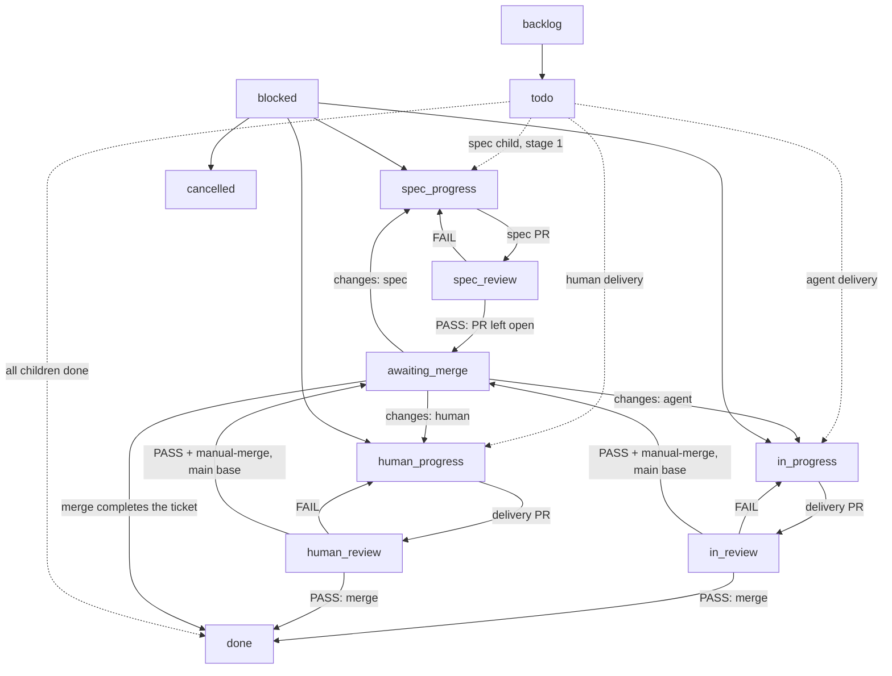

# Using the Factory workflow

The Factory workflow turns a spec into merged code. It is bound to every live project, so an
issue created in a project enters these columns; an issue outside a project uses the
workspace Default workflow, whose columns hand off to nobody.

The workflow file is the source: `templates/workflows/factory.json`. This guide is the
contract the human and the seats read. `tests/factory-workflow.test.js` fails when a column,
an edge or a mode is not described here. The route allocation behind the graph is
[ADR-0004](adr/0004-columns-carry-agent-decided-routes.md); the approval artifact is
[ADR-0005](adr/0005-the-merged-spec-pr-is-the-approval.md); [ADR-0006](adr/0006-comment-first-merge-last.md)
records the handoff order and the auto-merge ban; [ADR-0007](adr/0007-publish-the-slice-in-the-spec-run.md)
moves the slice publication into the spec run; [ADR-0008](adr/0008-spec-approval-targets-the-integration-branch.md)
retargets the approval merge at the integration branch and
[ADR-0009](adr/0009-release-the-spec-as-one-squash.md) releases the spec as one squash on
`main`.

## Status graph



Any ticket can enter `blocked`; it is a triage column, never a parking spot. `done` and
`cancelled` are terminal and hand off to nobody. The arrow labelled "merge completes the
ticket" is the platform's PR rule, not a status move: merging a linked pull request completes
the ticket it is linked to. The two delivery PASS edges are that same merge — the Reviewer
posts the verdict and merges; the column declares no advance of its own.

## The spec is a stage-1 child

The Planner creates the spec as the epic's stage-1 child and keeps the epic at `todo`. In that
child's run the Planner writes the spec, forks `spec/<epic>` from `main` at the spec sha before
the spec PR exists, publishes the whole slice with `to-tickets` — every delivery child under the
epic, in `backlog`, blockers first, stages assigned, the final-stage release child last — then
opens the spec PR carrying the proposed breakdown, against `spec/<epic>`, and links it only to
the child, never the epic, and never after `Closes`, `Fixes` or `Resolves`.
The Reviewer leaves the PR open on PASS and moves the child to `awaiting_merge`; the human
merges it, the workspace PR rule completes the child to `done`, and that completion wakes the
Planner to promote the frontier — not to slice. The merge still approves the spec and the set:
the children exist, but all are `backlog` and none has started.
No child is created after the merge: the set is final before the child closes.
Publishing before the child closes is what keeps the barrier wake single: the platform
re-evaluates the stage condition whenever the child set changes.

## One integration branch per spec

Each spec forks `spec/<epic>` from `main` at the spec sha, before the spec PR exists: a branch
needs a commit. The spec PR targets that branch, and its merge approves the spec, its proposed
breakdown and the published children exactly as before — only the target moves. Every delivery
child carries `Branch: spec/<epic>` under `## Parent`; that line, not a promotion comment, is
the base the Implementer reads, and a missing line means `main`. A final-stage release child
owns the only path from the branch to `main`.

```text
main ──fork at the spec sha──> spec/<epic>
                                  │  spec PR (approval) ───────────┐
                                  │  ticket PRs (reviewed, merged) ┤
                                  └── release child: spec → main ──┴──> one squash on main
```

`spec/*` is scratch: it is unprotected, it deploys nothing, and the release merge deletes it.
The branch's only jobs are to hold the reviewed spec until it is complete and to keep
half-finished work off `main`.

### The release child

The release child is published in the spec run, last, in `backlog`, in the final stage. Its
body carries the release procedure, base/source branch, included children and `Touch:` union.
Its PR is `spec/<epic>` → `main`: merge the current `main` in, resolve, run the full suite and
open at that head. That merge is one squash commit on `main` whose subject carries the release
ticket's key — no merge commit, no direct push — and it deletes the branch because
**Automatically delete head branches** is on.

CI runs at spec level: the release PR and the post-merge `main` push, two runs per spec
independent of N. Ticket PRs into `spec/<epic>` run no check, which is why the per-ticket gate
is the Implementer's local run of the check that covers the diff. A red release reworks on the
release ticket, on the branch, and re-runs at the refreshed head; children that are already
`done` stay `done`.

### `done` has two scopes

`done` has two scopes: branch-scoped `done` for a child and `main`-scoped `done` for the epic.
A child's `done` means it was delivered and reviewed on `spec/<epic>`. The epic's `done` is
`main`-scoped: after the release merge completes the release child, the Planner verifies the
release squash is on `main` at the merged sha with the release PR's checks green and only then
accepts the epic. The release child is the visible "this spec is not on `main` yet" marker; no
new status is introduced for the meaning between the two.

### Release serialization

At most one release is merge-ready against `main` at a time. Before promoting a release the
Planner runs `gh pr list --base main --state open`, filters the heads to `spec/*`, and while
another release is open parks the next one on `--until-issue <release>`. A release whose
`main` moves while it waits merges `main` in again and re-runs the suite: it never merges a
stale tree. The Reviewer's `mergeStateStatus` check and the human's merge button are the second
and third detectors.

### The cancelled-epic sweep

At approval the Planner registers `--until-status cancelled` on the epic. If the epic is
cancelled before its release merges, that sweep runs once and in order: close the open delivery
and release PRs, delete `spec/<epic>`, cancel the children that are still open, and record what
merged and what is abandoned. If the release already merged, do not cancel it: accept the epic,
or open a follow-up spec — a revert is a new epic.

### `direct-to-main` and the single-ticket default

Integration is the default. `direct-to-main` is the escape hatch that removes the topology
entirely: no `spec/<epic>`, no release child, the spec PR and every delivery PR target `main`,
and per-ticket CI returns. A spec whose approved breakdown is a single ticket defaults to it,
without anyone remembering a label. Every spec records `integration: spec/<epic>` or
`integration: none`, so the choice survives a rework and a later reader can see it.

## Columns

| Column | Handler | Entered by | Leaves to |
| --- | --- | --- | --- |
| `backlog` | none | the spec run parks every delivery child | `todo` or the stage's start column |
| `todo` | none | human or planner | a work column; the epic waits here |
| `spec_progress` | Planner | planner creates the spec child; its run publishes the slice | `spec_review` |
| `spec_review` | Reviewer | planner submits the spec PR | `spec_progress` (FAIL) or `awaiting_merge` (PASS) |
| `in_progress` | Implementer | planner promotes agent work | `in_review` |
| `human_progress` | human | planner promotes human work | `human_review` |
| `in_review` | Reviewer | the implementer delivers | `in_progress` (FAIL), `awaiting_merge` (PASS + `manual-merge` on a `main` base); otherwise the PASS merges into the recorded branch and completes it |
| `human_review` | Reviewer | the human delivers | `human_progress` (FAIL), `awaiting_merge` (PASS + `manual-merge` on a `main` base); otherwise the PASS merges into the recorded branch and completes it |
| `awaiting_merge` | human | reviewer PASS with `manual-merge` on a `main` base, or a spec PASS | `done` after the merge; the owning lane on changes |
| `blocked` | Planner | any seat that cannot proceed | triage route; a dependency wait stays |
| `done` | none | a merge, or the last handler | terminal |
| `cancelled` | none | any seat | terminal |

Custom statuses carry presentation that sync reconciles and reads back:

| Status | Icon | Colour |
| --- | --- | --- |
| `spec_progress` | `half` | `#3b82f6` |
| `spec_review` | `three_quarters` | `#3b82f6` |
| `human_progress` | `half` | `#8b5cf6` |
| `human_review` | `three_quarters` | `#8b5cf6` |
| `awaiting_merge` | `three_quarters` | `#8b5cf6` |

## Modes

A mode is chosen by the human before the spec is approved. The human adds the labels to the
epic, or states the mode for the Planner to apply: with neither label the epic is autonomous.
Changing a label after approval is a mode change: stop, re-approve, and re-route any ticket
already in flight.

| Mode | Epic labels | Implements | Reviews | Merges | Human work |
| --- | --- | --- | --- | --- | --- |
| autonomous | neither | Implementer | Reviewer | Reviewer merges after PASS | the spec merge |
| human merge | `manual-merge` | Implementer | Reviewer | human at `awaiting_merge`, only where the base is `main` | the spec merge and the merges onto `main` |
| human implements | `human-assigned` | human at `human_progress` | Reviewer | Reviewer merges after PASS | the spec merge, implementation |
| human implements and merges | `human-assigned` + `manual-merge` | human at `human_progress` | Reviewer | human at `awaiting_merge`, only where the base is `main` | the spec merge, implementation and the merges onto `main` |

`manual-merge` is scoped to the boundaries, not to every ticket: it gates the spec approval,
whatever its base, and every pull request whose base is `main`. A ticket PR into `spec/<epic>`
is Reviewer-merged in every mode, because the branch is scratch and the human already approved
the set that produces it. Integration otherwise costs two human merges — the spec and the
release — while `direct-to-main` keeps N + 1.

| Topology | Human merges under `manual-merge` |
| --- | --- |
| `spec/<epic>` | 2 — the spec approval and the release |
| `direct-to-main` | N + 1 — the spec approval and each of the N ticket PRs |

The spec lane runs in every mode: the Planner writes the spec at `spec_progress`, publishes the
slice, the Reviewer verdicts it at `spec_review`, and a PASS always lands at `awaiting_merge`.
The spec PR carries the proposed breakdown, and the human merge of that PR approves the spec,
the breakdown and the published children, in every mode, including autonomous.

To route one ticket to a human, assign that member and move it to `human_progress`; assigning
alone starts nothing. `todo` is a waiting room, not a handoff.

## Who moves what

- **Human.** The spec PR is the approval: it carries the proposed breakdown and the published
  children, so merging it approves the spec and the set. Add `human-assigned` and/or
  `manual-merge` to the epic before the merge when the mode needs them. Implement a
  `human-assigned` ticket at `human_progress`, open its PR against the ticket's `Branch:` base,
  and move it to `human_review`. At `awaiting_merge`, merge the reviewed PR: the merge
  completes the ticket, so do not move it to `done` yourself. Only a spec approval or a PR
  whose base is `main` reaches you there; a ticket PR into `spec/<epic>` is Reviewer-merged.
  Never move human work into `in_progress`.
- **Planner.** Create the spec as the epic's stage-1 child at `spec_progress`. In that run,
  fork `spec/<epic>` from `main` at the spec sha, write the spec recording `integration:`, and
  publish every delivery child in `backlog` with its stage, blockers and `Branch:` line, the
  final-stage release child last. Then link the spec PR, targeted at `spec/<epic>` or at `main`
  for a `direct-to-main` spec, to the child only. The merge approves the set and wakes you to
  promote, not to slice: create no child after it. Promote the frontier by moving agent work to
  `in_progress` and human work to `human_progress`, applying `ready-for-agent`; keep later
  stages in `backlog`. Before promoting a release, query open `spec/*` heads against `main` and
  park the next release while another is in flight. Triage `blocked`, run the cancelled-epic
  sweep, and accept the epic on evidence after the release merge.
- **Reviewer.** Owns `spec_review`, `in_review` and `human_review`: one verdict at the exact
  head, evidence per criterion, then the move or the merge. Post the verdict first, at the
  reviewed head, before the status move or the merge: the move starts the next handler and the
  merge completes the ticket, so anything written afterwards arrives too late for both. A spec
  PASS reviews the spec and its proposed breakdown, leaves the PR open and then moves to
  `awaiting_merge`; never merge or enable auto-merge on a spec PR. A delivery PASS posts the
  verdict at the exact head and then merges the PR into its base (squash, delete branch); the
  merge completes the ticket, so no status move follows. `manual-merge` moves only a PR whose
  base is `main` to `awaiting_merge`; a ticket PR into `spec/<epic>` merges in every mode. A
  release PASS checks `mergeStateStatus` against the current `main` first. FAIL comments the
  evidence and moves the ticket to the review column's back status. A review starts from an
  open pull request: with no open link, comment the state and send the ticket back rather than
  judging or completing it. The Reviewer never reviews its own work.
- **Implementer.** Owns `in_progress`: read the ticket's `Branch:` under `## Parent`, branch
  from that base (`main` when absent), open the PR against it, merge the base in before
  `in_review`, then implement, validate, link the PR and comment the handoff.
- **Release.** Owns production only; see `roles/release.md`.

The comment is the handoff: entering a column reassigns the issue to that column's handler and
starts their run; a member handler is assigned and runs nothing. Nothing advances a ticket when
a run ends, so the handler always makes the next move — after the comment, never before it.

## Commits

One pull request is one squash commit on the branch it targets, and the PR title is the
subject: `type(scope): summary, TICKET` — Conventional Commits, then a comma, then the ticket
key. GitHub appends the pull request number to the squash, `(#42)`; that is the only
parenthesis in the subject and nobody types it. Never use a merge commit and never rewrite the
squash subject. The PR body carries the detail; the subject carries the two identifiers and
nothing else.

## Edge cases

- **Review send-back.** Each review column declares its own back status: `spec_review` to
  `spec_progress`, `in_review` to `in_progress`, `human_review` to `human_progress`. The
  platform's needs-changes control uses that declared status, so a send-back cannot hand a
  ticket to the wrong seat.
- **Merge is the transition.** No review column declares `done`: `in_review` and `human_review`
  have no next status, and `spec_review` advances only to `awaiting_merge`. A delivery PASS
  merges the PR into its base and the platform completes the ticket; moving it to `done` by
  hand would close it without a merge, so don't. A change request moves it to the lane that
  owns the work.
- **The release is a delivery PR with a `main` base.** The release child is reviewed at
  `in_review` like any other ticket: a PASS merges it in autonomous mode, and `manual-merge`
  sends it to `awaiting_merge` because its base is `main`. It is not a second approval — the
  spec merge approved the set, and the release adds no criteria of its own. A red release
  reworks on the release ticket at `in_progress`; its `done` children stay `done`.
- **A cancelled epic is swept once.** The sweep in "The cancelled-epic sweep" is mechanical:
  close the open delivery and release PRs, delete `spec/<epic>`, cancel the remaining children
  and record what merged and what is abandoned. It runs from the `--until-status cancelled`
  condition, not from a comment.
- **Auto-merge stays off.** Leave **Allow auto-merge** off on every Factory repository. Auto-merge
  is a pull-request setting, not a ticket status: an armed PR merges as soon as its checks pass,
  and the platform completes the linked ticket on merge — including an
  `awaiting_merge` ticket and a spec child. An arm would therefore bypass the human gate, and
  a spec merge would approve an unreviewed set and wake the Planner to promote it. The Reviewer
  merges after a PASS instead, and GitHub refuses an arm while the setting is off.
- **A close is not a workflow event.** The platform completes a ticket on merge and does
  nothing on a close: a closed, unmerged PR changes no status, wakes nobody, and is not an
  automatic rejection — rejected, superseded, rebased and cancelled PRs all close the same
  way, so a close cannot be assumed to mean any of them. The actor who closes the PR owns the
  move: `cancelled` for abandoned work, or the lane that owns the rework, with the reason on
  the ticket. There is no CLI unlink, so a human who closes a linked PR removes the stale link
  on the issue page before linking a replacement.
- **A review needs an open PR.** Each review column checks the link before judging: with no
  open pull request there is nothing to review, so the Reviewer comments the state and moves
  the ticket to that column's back status. This is a precondition on entry, not a reaction to
  a close — nothing in the graph fires on one.
- **Spec approval.** The spec child is approved by merging its PR, which completes the child
  and wakes the Planner. The PR targets `spec/<epic>`, or `main` on a `direct-to-main` spec,
  and carries the proposed breakdown and the published children, so the merge approves both;
  the children already exist in `backlog`, and the wake promotes the frontier. A spec PR is
  reviewed at `spec_review`, never at `in_review`, and the Reviewer never merges or enables
  auto-merge on it.
- **Publishing before approval.** The spec run publishes the children before the merge because
  creating them after it is exactly the child-set change that fires the barrier twice. They are
  a proposed set, not approved work: all `backlog`, none in a running status, no
  `ready-for-agent` until the promotion wake. On a spec FAIL the spec run reconciles them to the
  revised breakdown; if the epic is abandoned, cancel them with it.
- **Blocked.** Any seat can move a ticket to `blocked`. The Planner triages it to a work
  column, or cancels it. A ticket waiting on another ticket names it in a `Blocked by` section
  in its body and stays in `blocked` until that ticket closes; a dependency is not triage.
- **Cancel and duplicate.** Move to `cancelled`; use `--duplicate-of` so the original lists it.
- **Branch cleanup.** Enable **Automatically delete head branches** on the repository. Every
  delivery merge deletes its head branch, and the release merge deletes `spec/<epic>`; a merge
  from the GitHub UI relies on that setting, and the catalog cannot set it. Auto-merge is off,
  so no deferred merge exists.
- **Issue outside a project.** The workspace Default workflow accepts every status and hands
  off to nobody. The Factory modes above do not apply until the issue is in a project.
- **Manual override.** Any member can move a ticket to any column; the move is the handoff and
  the new handler takes over. A named workflow refuses a status it does not declare.
- **Stage barriers.** A stage is a parallel barrier group, not a position label: serial
  tickets get distinct stages, the spec run creates every later stage in `backlog`, and the
  closing stage wakes the parent. The slicing rules live in `roles/planner.md` and the
  `to-tickets` skill.

## Live acceptance

The offline matrix pins the graph and the mode routes; it cannot prove the platform's
handoff. Run this once after a catalog change reaches a workspace, in a throwaway project
with a repository resource and the Factory workflow bound.

| Scenario | Shape | Expected evidence |
| --- | --- | --- |
| autonomous | epic, spec child + three parallel children + one serial child | the whole slice already exists in `backlog` when the spec PR is reviewed; the human merge completes the child and a **single** Planner wake promotes the parallel stage (no child is created after the merge); each PASS is posted before its delivery PR merges and closes the ticket |
| integration topology | the same slice with the fork, the release child and filtered triggers | the spec PR and every delivery PR target `spec/<epic>`; a child's PASS merges into the branch and completes the child, with no CI run started for the branch; the release PR runs the repository's checks and lands as one squash on `main`, deleting the branch; the Planner then accepts the epic on evidence |
| release serialization | two integration epics with a release ready | only one release PR is open against `main`; the second release stays `backlog` until the first closes, then merges the moved `main` in and re-runs before its PR opens |
| cancelled epic | an integration epic cancelled before its release merges | the open delivery and release PRs close, `spec/<epic>` is deleted, the remaining children are cancelled, and the record says what merged and what is abandoned |
| direct-to-main | a single-ticket breakdown | the spec PR targets `main`, there is no branch and no release child, and the ticket PR runs CI |
| spec rework | a spec FAIL after the slice is published | the children stay `backlog`; the spec run reconciles them to the revised breakdown; no run starts |
| human merge | `manual-merge` ticket | PASS lands at `awaiting_merge`; the human merges and the merge completes the ticket |
| human implements | `human-assigned` ticket | the ticket sits in `human_progress` assigned to the human; its PR is reviewed at `human_review`, the PASS is posted, then merged |
| human implements and merges | both labels | `human_progress` to `human_review` to `awaiting_merge`; the human merges |
| blocked | any ticket moved to `blocked` | the Planner triages it back to a work column or cancels it |
| dependency | a ticket whose body names an open blocker | it stays in `blocked` until the blocker closes |

Record `multica issue timeline <id>` before closing each item: it carries the status and
assignee changes that prove the route. Put the result on the test issue, not in this
repository: the catalog is stateless, and this guide is the procedure, not a workspace
record. Cancel the test tickets and close the test PRs afterwards, then delete the throwaway
project.

## Verification

`just validate` resolves the catalog; `just test` runs the offline matrix. Both are offline
and need no workspace.
