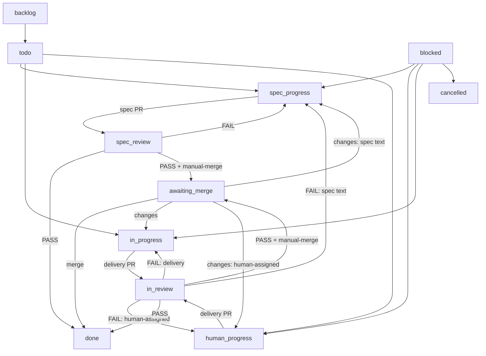

# Using the Factory workflow

The Factory workflow turns a spec into merged code. It is bound to every live project, so an
issue created in a project enters these columns; an issue outside a project uses the
workspace Default workflow, whose columns hand off to nobody.

The workflow file is the source: `templates/workflows/factory.json`. This guide is the
contract the human and the seats read. `tests/factory-workflow.test.js` fails when a column,
an edge or a mode is not described here.

## Status graph

Any ticket can enter `blocked`; it is a triage column, never a parking spot. `done` and
`cancelled` are terminal and hand off to nobody.

## Columns

| Column | Handler | Entered by | Leaves to |
| --- | --- | --- | --- |
| `backlog` | none | planner parks a later stage | `todo` or the stage's start column |
| `todo` | none | human or planner | a work column; the ticket waits here |
| `spec_progress` | Planner | planner starts a spec | `spec_review` |
| `spec_review` | Reviewer | planner submits the spec PR | `spec_progress` (FAIL) or `done` / `awaiting_merge` (PASS) |
| `in_progress` | Implementer | planner promotes agent work | `in_review` |
| `human_progress` | human | planner promotes human work | `in_review` |
| `in_review` | Reviewer | implementer or human delivers | `in_progress`, `human_progress`, `spec_progress` on FAIL; `done` or `awaiting_merge` on PASS |
| `awaiting_merge` | human | reviewer PASS with `manual-merge` | `done` after merge; back on changes |
| `blocked` | Planner | any seat that cannot proceed | triage route |
| `done` | none | the last handler | terminal |
| `cancelled` | none | any seat | terminal |

Custom statuses carry presentation that sync reconciles and reads back:

| Status | Icon | Colour |
| --- | --- | --- |
| `spec_progress` | `half` | `#3b82f6` |
| `spec_review` | `three_quarters` | `#3b82f6` |
| `human_progress` | `half` | `#8b5cf6` |
| `awaiting_merge` | `three_quarters` | `#8b5cf6` |

## Modes

A mode is chosen by the human before the spec is approved. The human adds the labels to the
epic, or states the mode for the Planner to apply: with neither label the epic is autonomous.
Changing a label after approval is a mode change: stop, re-approve, and re-route any ticket
already in flight.

| Mode | Epic labels | Implements | Reviews | Merges | Human work |
| --- | --- | --- | --- | --- | --- |
| autonomous | neither | Implementer | Reviewer | Reviewer arms auto-merge | one approval comment |
| human merge | `manual-merge` | Implementer | Reviewer | human at `awaiting_merge` | approval, merge |
| human implements | `human-assigned` | human at `human_progress` | Reviewer | Reviewer arms auto-merge | approval, implementation |
| human implements and merges | `human-assigned` + `manual-merge` | human at `human_progress` | Reviewer | human at `awaiting_merge` | approval, implementation, merge |

The spec lane runs in every mode: the Planner writes the spec at `spec_progress`, the
Reviewer verdicts it at `spec_review`, and a PASS lands the spec PR at `awaiting_merge` when
`manual-merge` is on the epic and at `done` otherwise.

To route one ticket to a human, assign that member and move it to `human_progress`; assigning
alone starts nothing. `todo` is a waiting room, not a handoff.

## Who moves what

- **Human.** One approval comment approves the spec and the ticket breakdown. Add
  `human-assigned` and/or `manual-merge` to the epic before that comment when the mode needs
  them. Implement a `human-assigned` ticket at `human_progress`, open its PR, and move it to
  `in_review`. Merge at `awaiting_merge` when satisfied. Never move human work into
  `in_progress`.
- **Planner.** Owns `spec_progress`: rework the spec, link one PR, move to `spec_review`.
  Slice only after approval, one ticket and one PR per slice. Promote a stage by moving its
  agent work to `in_progress` and its human work to `human_progress`; keep later stages in
  `backlog`. Triage `blocked` and accept the epic when every child closes.
- **Reviewer.** Owns `spec_review` and `in_review`: one verdict at the exact head, evidence
  per criterion, a status move at the end. PASS arms auto-merge only after the verdict and
  moves to `done`, or to `awaiting_merge` when `manual-merge` is on the ticket or its parent.
  FAIL moves spec text to `spec_progress`, human-assigned delivery to `human_progress`, and
  other delivery to `in_progress`. The Reviewer never merges by hand and never reviews its
  own work.
- **Implementer.** Owns `in_progress`: implement, validate, link the PR, move to `in_review`.
- **Release.** Owns production only; see `roles/release.md`.

The status move is the handoff: entering a column reassigns the issue to that column's
handler and starts their run; a member handler is assigned and runs nothing. Nothing advances
a ticket when a run ends, so the handler always makes the next move.

## Edge cases

- **Review send-back.** `in_review` names `in_progress` as its needs-changes column, which is
  right for agent delivery. A human-assigned ticket sent back there would hand the work to the
  Implementer, so the Reviewer moves it to `human_progress` explicitly, and the human does the
  same if using the review control.
- **Blocked.** Any seat can move a ticket to `blocked`. The Planner triages it to a work
  column, or cancels it; a blocker is never left parked.
- **Cancel and duplicate.** Move to `cancelled`; use `--duplicate-of` so the original lists it.
- **Issue outside a project.** The workspace Default workflow accepts every status and hands
  off to nobody. The Factory modes above do not apply until the issue is in a project.
- **Manual override.** Any member can move a ticket to any column; the move is the handoff and
  the new handler takes over. A named workflow refuses a status it does not declare.
- **Stage barriers.** A stage is a parallel barrier group, not a position label: serial
  tickets get distinct stages, later stages are created in `backlog`, and the closing stage
  wakes the parent. The slicing rules live in `roles/planner.md` and the `to-tickets` skill.

## Live acceptance

The offline matrix pins the graph and the mode routes; it cannot prove the platform's
handoff. Run this once after a catalog change reaches a workspace, in a throwaway project
with a repository resource and the Factory workflow bound.

| Scenario | Shape | Expected evidence |
| --- | --- | --- |
| autonomous | epic, spec + three parallel children + one serial child | spec and delivery PRs review, auto-merge and close; the parent wakes per stage |
| human merge | `manual-merge` ticket | PASS lands at `awaiting_merge`; the human merges and moves to `done` |
| human implements | `human-assigned` ticket | the ticket sits in `human_progress` assigned to the human; a human PR is reviewed and auto-merged |
| human implements and merges | both labels | `human_progress` to `in_review` to `awaiting_merge`; the human merges |
| blocked | any ticket moved to `blocked` | the Planner triages it back to a work column or cancels it |

Record `multica issue timeline <id>` before closing each item: it carries the status and
assignee changes that prove the route. Put the result on the test issue, not in this
repository: the catalog is stateless, and this guide is the procedure, not a workspace
record. Cancel the test tickets and close the test PRs afterwards, then delete the throwaway
project.

## Verification

`just validate` resolves the catalog; `just test` runs the offline matrix. Both are offline
and need no workspace.
