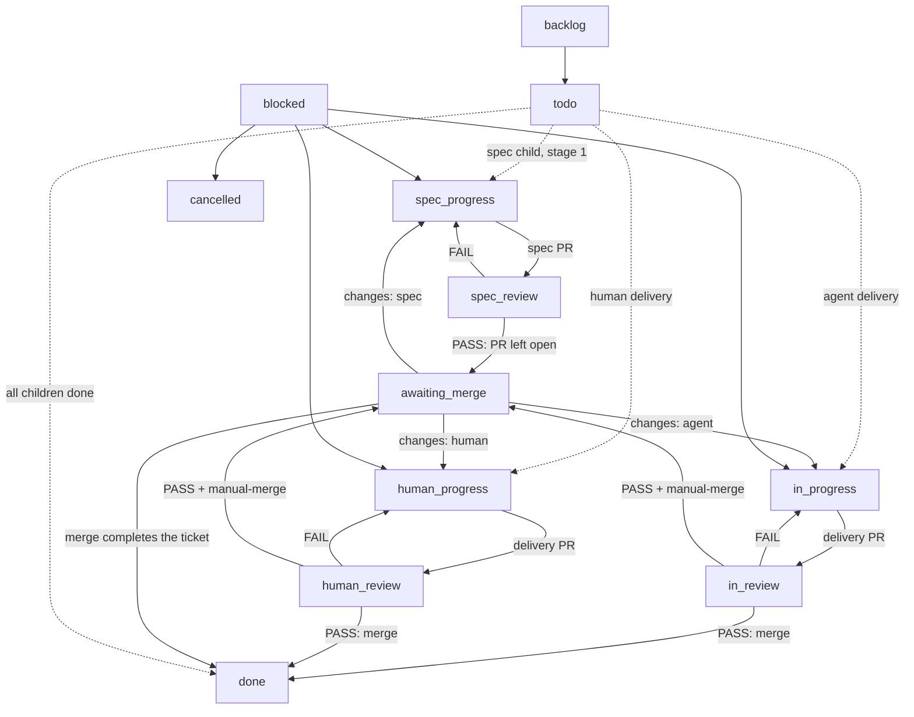

# Using the Factory workflow

The Factory workflow turns a spec into merged code. It is bound to every live project, so an
issue created in a project enters these columns; an issue outside a project uses the
workspace Default workflow, whose columns hand off to nobody.

The workflow file is the source: `templates/workflows/factory.json`. This guide is the
contract the human and the seats read. `tests/factory-workflow.test.js` fails when a column,
an edge or a mode is not described here. The route allocation behind the graph is
[ADR-0004](adr/0004-columns-carry-agent-decided-routes.md); the approval artifact is
[ADR-0005](adr/0005-the-merged-spec-pr-is-the-approval.md); [ADR-0006](adr/0006-comment-first-merge-last.md)
records the handoff order and the auto-merge ban.

## Status graph

Any ticket can enter `blocked`; it is a triage column, never a parking spot. `done` and
`cancelled` are terminal and hand off to nobody. The arrow labelled "merge completes the
ticket" is the platform's PR rule, not a status move: merging a linked pull request completes
the ticket it is linked to. The two delivery PASS edges are that same merge — the Reviewer
posts the verdict and merges; the column declares no advance of its own.

## The spec is a stage-1 child

The Planner creates the spec as the epic's stage-1 child and keeps the epic at `todo`. The
spec PR carries the proposed breakdown and links only that child — never the epic, and never
after `Closes`, `Fixes` or `Resolves`. The Reviewer leaves the spec PR open on PASS and moves
the child to `awaiting_merge`; the human merges it, the workspace PR rule completes the child
to `done`, and that completion wakes the Planner to slice. So there is no approval column and
no per-issue auto-complete override: the merge approves the spec and the breakdown, and the
epic is accepted only after every child closes.

## Columns

| Column | Handler | Entered by | Leaves to |
| --- | --- | --- | --- |
| `backlog` | none | planner parks a later stage | `todo` or the stage's start column |
| `todo` | none | human or planner | a work column; the epic waits here |
| `spec_progress` | Planner | planner creates the spec child | `spec_review` |
| `spec_review` | Reviewer | planner submits the spec PR | `spec_progress` (FAIL) or `awaiting_merge` (PASS) |
| `in_progress` | Implementer | planner promotes agent work | `in_review` |
| `human_progress` | human | planner promotes human work | `human_review` |
| `in_review` | Reviewer | the implementer delivers | `in_progress` (FAIL), `awaiting_merge` (PASS + `manual-merge`); otherwise the PASS merges and completes it |
| `human_review` | Reviewer | the human delivers | `human_progress` (FAIL), `awaiting_merge` (PASS + `manual-merge`); otherwise the PASS merges and completes it |
| `awaiting_merge` | human | reviewer PASS with `manual-merge`, or a spec PASS | `done` after the merge; the owning lane on changes |
| `blocked` | Planner | any seat that cannot proceed | triage route; a dependency wait stays |
| `done` | none | a merge, or the last handler | terminal |
| `cancelled` | none | any seat | terminal |

Custom statuses carry presentation that sync reconciles and reads back:

| Status | Icon | Colour |
| --- | --- | --- |
| `spec_progress` | `half` | `#3b82f6` |
| `spec_review` | `three_quarters` | `#3b82f6` |
| `human_progress` | `half` | `#8b5cf6` |
| `human_review` | `three_quarters` | `#8b5cf6` |
| `awaiting_merge` | `three_quarters` | `#8b5cf6` |

## Modes

A mode is chosen by the human before the spec is approved. The human adds the labels to the
epic, or states the mode for the Planner to apply: with neither label the epic is autonomous.
Changing a label after approval is a mode change: stop, re-approve, and re-route any ticket
already in flight.

| Mode | Epic labels | Implements | Reviews | Merges | Human work |
| --- | --- | --- | --- | --- | --- |
| autonomous | neither | Implementer | Reviewer | Reviewer merges after PASS | the spec merge |
| human merge | `manual-merge` | Implementer | Reviewer | human at `awaiting_merge` | the spec merge, the delivery merge |
| human implements | `human-assigned` | human at `human_progress` | Reviewer | Reviewer merges after PASS | the spec merge, implementation |
| human implements and merges | `human-assigned` + `manual-merge` | human at `human_progress` | Reviewer | human at `awaiting_merge` | the spec merge, implementation, the delivery merge |

The spec lane runs in every mode: the Planner writes the spec at `spec_progress`, the
Reviewer verdicts it at `spec_review`, and a PASS always lands at `awaiting_merge`. The spec
PR carries the proposed breakdown, and the human merge of that PR approves both, in every
mode, including autonomous.

To route one ticket to a human, assign that member and move it to `human_progress`; assigning
alone starts nothing. `todo` is a waiting room, not a handoff.

## Who moves what

- **Human.** The spec PR is the approval: it carries the proposed breakdown, so merging it
  approves both. Add `human-assigned` and/or `manual-merge` to the epic before the merge when
  the mode needs them. Implement a `human-assigned` ticket at `human_progress`, open its PR,
  and move it to `human_review`. At `awaiting_merge`, merge the reviewed PR: the merge
  completes the ticket, so do not move it to `done` yourself. Never move human work into
  `in_progress`.
- **Planner.** Create the spec as the epic's stage-1 child at `spec_progress`; the spec carries
  the proposed breakdown; link the spec PR to that child only. Slice only after the spec child
  is done. Promote a stage by moving its agent work to `in_progress` and its human work to
  `human_progress`; keep later stages in `backlog`. Triage `blocked` and accept the epic when
  every child closes.
- **Reviewer.** Owns `spec_review`, `in_review` and `human_review`: one verdict at the exact
  head, evidence per criterion, then the move or the merge. Post the verdict first, at the
  reviewed head, before the status move or the merge: the move starts the next handler and the
  merge completes the ticket, so anything written afterwards arrives too late for both. A spec
  PASS reviews the spec and its proposed breakdown, leaves the PR open and then moves to
  `awaiting_merge`; never merge or enable auto-merge on a spec PR. A delivery PASS posts the
  verdict at the exact head and then merges (squash, delete branch); the merge completes the
  ticket, so no status move follows. With `manual-merge`, post the PASS and move to
  `awaiting_merge`. FAIL comments the evidence and moves the ticket to the review column's back
  status. A review starts from an open pull request: with no open link, comment the state and
  send the ticket back rather than judging or completing it. The Reviewer never reviews its own
  work.
- **Implementer.** Owns `in_progress`: implement, validate, link the PR, comment the handoff,
  then move to `in_review`.
- **Release.** Owns production only; see `roles/release.md`.

The comment is the handoff: entering a column reassigns the issue to that column's handler and
starts their run; a member handler is assigned and runs nothing. Nothing advances a ticket when
a run ends, so the handler always makes the next move — after the comment, never before it.

## Commits

One pull request is one squash commit on the branch it targets, and the PR title is the
subject: `type(scope): summary, TICKET` — Conventional Commits, then a comma, then the ticket
key. GitHub appends the pull request number to the squash, `(#42)`; that is the only
parenthesis in the subject and nobody types it. Never use a merge commit and never rewrite the
squash subject. The PR body carries the detail; the subject carries the two identifiers and
nothing else.

## Edge cases

- **Review send-back.** Each review column declares its own back status: `spec_review` to
  `spec_progress`, `in_review` to `in_progress`, `human_review` to `human_progress`. The
  platform's needs-changes control uses that declared status, so a send-back cannot hand a
  ticket to the wrong seat.
- **Merge is the transition.** No review column declares `done`: `in_review` and `human_review`
  have no next status, and `spec_review` advances only to `awaiting_merge`. A delivery PASS
  merges the PR and the platform completes the ticket; moving it to `done` by hand would close
  it without a merge, so don't. A change request moves it to the lane that owns the work.
- **Auto-merge stays off.** Leave **Allow auto-merge** off on every Factory repository. Auto-merge
  is a pull-request setting, not a ticket status: an armed PR merges as soon as its checks pass,
  and the platform completes the linked ticket on merge from any non-terminal status — including
  `awaiting_merge` and a spec child. An arm would therefore bypass the human gate, and a spec
  merge would wake the Planner to slice an unapproved breakdown. The Reviewer merges after a
  PASS instead, and GitHub refuses an arm while the setting is off.
- **A close is not a workflow event.** The platform completes a ticket on merge and does
  nothing on a close: a closed, unmerged PR changes no status, wakes nobody, and is not an
  automatic rejection — rejected, superseded, rebased and cancelled PRs all close the same
  way, so a close cannot be assumed to mean any of them. The actor who closes the PR owns the
  move: `cancelled` for abandoned work, or the lane that owns the rework, with the reason on
  the ticket. There is no CLI unlink, so a human who closes a linked PR removes the stale link
  on the issue page before linking a replacement.
- **A review needs an open PR.** Each review column checks the link before judging: with no
  open pull request there is nothing to review, so the Reviewer comments the state and moves
  the ticket to that column's back status. This is a precondition on entry, not a reaction to
  a close — nothing in the graph fires on one.
- **Spec approval.** The spec child is approved by merging its PR, which completes the child
  and wakes the Planner. The PR carries the proposed breakdown, so the merge approves both. A
  spec PR is reviewed at `spec_review`, never at `in_review`, and the Reviewer never merges or
  enables auto-merge on it.
- **Blocked.** Any seat can move a ticket to `blocked`. The Planner triages it to a work
  column, or cancels it. A ticket waiting on another ticket names it in a `Blocked by` section
  in its body and stays in `blocked` until that ticket closes; a dependency is not triage.
- **Cancel and duplicate.** Move to `cancelled`; use `--duplicate-of` so the original lists it.
- **Branch cleanup.** Enable **Automatically delete head branches** on the repository. The
  instructions delete the head branch they merge, but a merge from the GitHub UI relies on
  that setting; the catalog cannot set it. Auto-merge is off, so no deferred merge exists.
- **Issue outside a project.** The workspace Default workflow accepts every status and hands
  off to nobody. The Factory modes above do not apply until the issue is in a project.
- **Manual override.** Any member can move a ticket to any column; the move is the handoff and
  the new handler takes over. A named workflow refuses a status it does not declare.
- **Stage barriers.** A stage is a parallel barrier group, not a position label: serial
  tickets get distinct stages, later stages are created in `backlog`, and the closing stage
  wakes the parent. The slicing rules live in `roles/planner.md` and the `to-tickets` skill.

## Live acceptance

The offline matrix pins the graph and the mode routes; it cannot prove the platform's
handoff. Run this once after a catalog change reaches a workspace, in a throwaway project
with a repository resource and the Factory workflow bound.

| Scenario | Shape | Expected evidence |
| --- | --- | --- |
| autonomous | epic, spec child + three parallel children + one serial child | the spec PR is reviewed, left open, merged by the human, the child closes and the Planner slices; each PASS is posted before its delivery PR merges and closes the ticket |
| human merge | `manual-merge` ticket | PASS lands at `awaiting_merge`; the human merges and the merge completes the ticket |
| human implements | `human-assigned` ticket | the ticket sits in `human_progress` assigned to the human; its PR is reviewed at `human_review`, the PASS is posted, then merged |
| human implements and merges | both labels | `human_progress` to `human_review` to `awaiting_merge`; the human merges |
| blocked | any ticket moved to `blocked` | the Planner triages it back to a work column or cancels it |
| dependency | a ticket whose body names an open blocker | it stays in `blocked` until the blocker closes |

Record `multica issue timeline <id>` before closing each item: it carries the status and
assignee changes that prove the route. Put the result on the test issue, not in this
repository: the catalog is stateless, and this guide is the procedure, not a workspace
record. Cancel the test tickets and close the test PRs afterwards, then delete the throwaway
project.

## Verification

`just validate` resolves the catalog; `just test` runs the offline matrix. Both are offline
and need no workspace.
